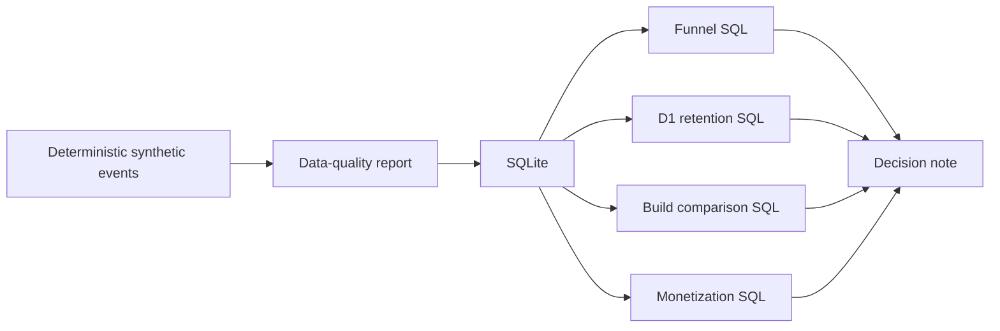

# Game Product Analytics Lab

A reproducible, dependency-free analytics example built on deterministic
synthetic mobile-game events. It connects event contracts, data-quality checks,
funnel and retention SQL, build comparison, monetization, and a decision note.

[](https://github.com/oguzhanozfe/game-product-analytics-lab/actions/workflows/ci.yml)

> Portfolio scope: no production player, device, advertising, or purchase data
> is included. The fixture is synthetic and the results are not business claims.

## Reproducible snapshot

| Synthetic build | Tutorial complete | Level 20 complete | D1 retention |
|---|---:|---:|---:|
| 101 | 90% | 50% | 40% |
| 102 | 90% | 70% | 60% |

The decision note treats this difference as a signal for the next test, not as
proof that one build caused better retention.

## Workflow



## Run locally

Python 3.11+ is enough; there are no runtime dependencies.

```bash
python3 -m unittest discover -s tests -v
python3 scripts/run_analysis.py
```

The analysis command regenerates `data/derived/events.csv`, loads it into an
in-memory SQLite database, and prints every SQL result as a Markdown table.

## Repository map

- [`generate_data.py`](src/game_analytics/generate_data.py) — deterministic
  synthetic event generator
- [`event-contract.md`](docs/event-contract.md) — schema and data boundary
- [`sql/`](sql/) — data quality, funnel, D1, build, and monetization queries
- [`measurement-principles.md`](docs/measurement-principles.md) — interpretation
  rules
- [`sample-decision-note.md`](reports/sample-decision-note.md) — observation,
  uncertainty, decision, and next-test separation
- [`tests/`](tests/) and GitHub Actions — repeatability checks

## What this demonstrates

- Designing an analytics contract before interpreting metrics
- Building reproducible funnel, retention, cohort/build, and revenue queries
- Reporting event quality before reading metrics
- Separating observation, correlation, causal proof, and product action
- Communicating a decision without presenting immature or confounded data as a
  winner

## Limits

This is a compact portfolio lab, not an experimentation platform. It does not
include identity resolution, attribution reconciliation, warehouse
orchestration, dashboard hosting, privacy consent, or production monitoring.

## License

MIT for the code and documentation in this repository.
